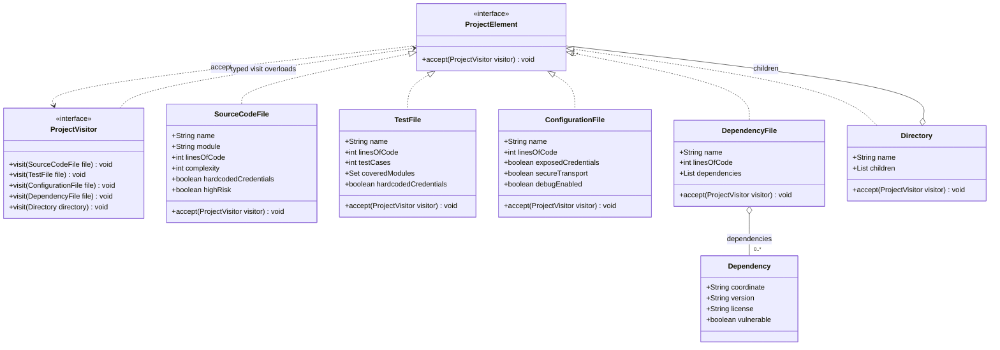
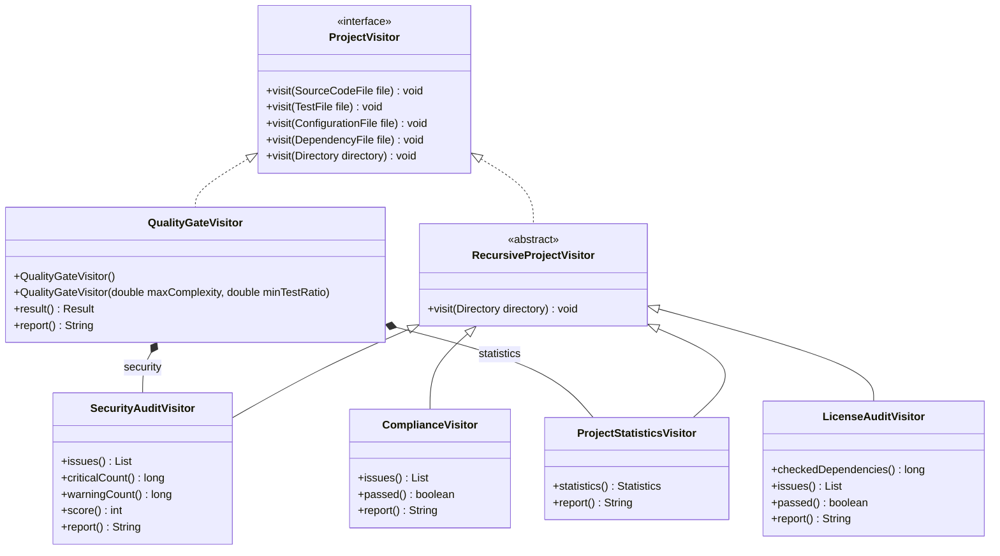
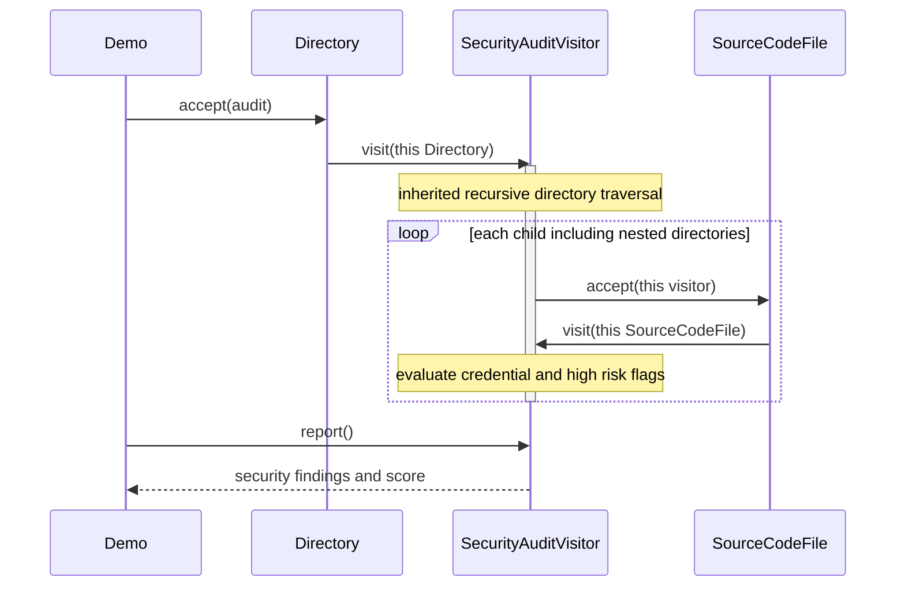

# Smart Code Inspection and Compliance Engine

Assignment 6 — Visitor Pattern, Java 17.

**Student:** Yerbol Alikhan  
**Group:** SE-2517

The engine models a software project as immutable elements and runs five independent inspection operations on the same object tree. It demonstrates double dispatch, recursive directory traversal, and a release gate built by composing existing visitors.

This is a **metadata inspection engine**: the demo constructs records containing source metrics, credential flags, declared test coverage, and dependency metadata. It does not parse real Java files, execute application tests, or query a vulnerability database. The sample dependency coordinates and vulnerability flags are fictional fixtures.

## Build

Requires JDK 17 or newer and Maven 3.9 or newer.

```bash
mvn clean verify
java -jar target/smart-code-inspection-1.0.0.jar
```

On Windows, run the same commands in PowerShell or the IntelliJ terminal. Use a **JDK**, not only a JRE. Maven downloads the pinned build plugins and JUnit dependencies on the first run.

## Project structure

| Location | Purpose |
| --- | --- |
| `src/main/java/kz/aitu/inspection/model` | Five concrete elements, dependency value object, validation |
| `src/main/java/kz/aitu/inspection/visitor` | Visitor contract, recursive traversal, five visitors, findings |
| `src/main/java/kz/aitu/inspection/DemoProjects.java` | Risky and corrected fintech metadata fixtures |
| `src/main/java/kz/aitu/inspection/Demo.java` | Runs all five visitors on each fixture |
| `src/test/java/kz/aitu/inspection` | 35 meaningful JUnit 5 tests |
| `docs/demo-output.txt` | Captured console output of the runnable JAR |
| `docs/DEFENSE.md` | Explanation and live modification guide |
| `docs/PUBLISH.md` | Publish the existing Git history to a new public repository |
| `.github/workflows/ci.yml` | Java 17 build and test workflow |

The first fixture has the required conceptual layout: `fintech-project/src/PaymentService.java`, `src/UserService.java`, `tests/PaymentServiceTest.java`, `config/application.properties`, and `pom.xml`. `Directory` objects represent these folders in memory; they are not extra Java source trees on disk.

## Operations and rules

| Visitor | Behavior |
| --- | --- |
| `SecurityAuditVisitor` | Critical findings for exposed credentials in source, tests, or configuration; flagged high-risk source; disabled secure transport; flagged vulnerable dependencies. Debug mode produces a warning. |
| `ProjectStatisticsVisitor` | File and directory counts, total lines, source and test file counts, test case count, dependency declarations, average source complexity, test/source file ratio. |
| `QualityGateVisitor` | Security passes when critical findings are zero; complexity passes at an average of 10 or less; tests pass at a file ratio of at least 0.40. At least one source file is required. Thresholds are configurable. |
| `ComplianceVisitor` | No exposed credentials; every dependency needs a nonblank version; every production module needs declared tests; prohibited dependency coordinates are rejected. |
| `LicenseAuditVisitor` | Additional visitor committed separately. Reports missing license identifiers and identifiers outside a configurable approval set. |

Security score is `max(0, 100 - 20 * criticalCount - 5 * warningCount)`. It is a demonstration policy rather than an industry security rating. Release decisions use critical finding counts rather than the score. A debug-only warning does not fail the zero-critical gate.

Default prohibited dependency: `com.legacy:unsafe-crypto`. The license policy approves `MIT`, `Apache-2.0`, `BSD-2-Clause`, `BSD-3-Clause`, and `ISC` identifiers. Approval is exact and case sensitive. Missing license metadata requires review and fails the license audit. This is a sample organizational allowlist, not a license compatibility analysis; SPDX expressions are not parsed.

### Metric definitions and edge cases

- A file is a source, test, configuration, or dependency element; directories do not increase the file count. Directory counts include the root.
- Total lines include all four file categories, including configuration and dependency manifests.
- Average complexity is the arithmetic mean over source files only, not weighted by lines of code.
- Test/source ratio means **test file count divided by source file count**, not coverage percentage or test case count. No source files yields zero rather than NaN or infinity; an empty project fails the release gate.
- Test cases are declared counts. Module coverage is declared by `TestFile.coveredModules`; it is not measured code coverage. A zero-case test file cannot claim module coverage. Empty test files still count as files under the defined ratio, so passing the ratio alone is not evidence of effective testing.
- Compliance evaluates untested modules after traversal, so directory order does not affect the result. Multiple source files may belong to one module; one test may cover multiple modules.
- Dependencies count declarations, including duplicates. Long integer totals avoid overflow when adding large per-file metrics.
- Inputs reject negative metrics, blank names, null collection entries, and inconsistent zero-case coverage. Missing dependency versions and licenses remain representable for reporting.
- Collections are defensively copied. Visitors never change elements. Directory objects form an acyclic immutable structure; reusing the same object in two child positions counts it twice, once per occurrence.
- Visitors accumulate results. Create a **fresh visitor per inspection run**. Reports do not mutate state and can be called repeatedly. Visitors are not thread safe.
- Recursive traversal is verified at 100 nested directories. Arbitrarily deep untrusted trees could exceed the Java call stack; an explicit traversal stack would be appropriate for such input.

The quality gate checks the three required criteria and source presence. Compliance and license audits report separately; a caller that needs all policies for release should combine all three final results.

## Demo results

All five visitors receive the exact same root object for each fixture.

| Metric | Original fixture | Corrected fixture |
| --- | ---: | ---: |
| Files | 5 | 6 |
| Directories | 4 | 4 |
| Lines | 530 | 570 |
| Test cases | 8 | 13 |
| Dependency declarations | 2 | 1 |
| Average source complexity | 11.00 | 7.00 |
| Test/source file ratio | 0.50 | 1.00 |
| Critical security findings | 5 | 0 |
| Security warnings | 1 | 0 |
| Security score | 0 | 100 |
| Compliance violations | 5 | 0 |
| License findings | 1 | 0 |
| Quality gate | FAILED | PASSED |

The original fixture passes the test file ratio while failing module compliance because the users module has no declared tests. These policies answer different questions. Full output is in [docs/demo-output.txt](docs/demo-output.txt).

## Visitor pattern questions

### What problem does Visitor solve here

The same project structure needs many operations. Visitor keeps security, statistics, release rules, compliance, and licensing out of the data classes. A new operation is implemented as a new visitor instead of adding an operation method to every element.

### Where are Element and Visitor

`ProjectElement` is the Element interface. `SourceCodeFile`, `TestFile`, `ConfigurationFile`, `DependencyFile`, and `Directory` are concrete elements. `ProjectVisitor` declares a typed `visit` method for every concrete element. The five operation classes implement that interface directly or through `RecursiveProjectVisitor`.

### What is double dispatch

Given `ProjectElement element = new SourceCodeFile(...)` and `ProjectVisitor visitor = new SecurityAuditVisitor()`, `element.accept(visitor)` first dispatches to the runtime element's `SourceCodeFile.accept`. Inside that method, `this` has compile-time type `SourceCodeFile`, so Java selects the `visit(SourceCodeFile)` overload. The visitor object's runtime type then selects `SecurityAuditVisitor.visit(SourceCodeFile)`.

The result depends on both the element type and the visitor type. Java overload selection is compile time; overriding dispatch is runtime. Merely calling `visitor.visit(element)` would not work because no `visit(ProjectElement)` overload exists. There are no element-type `instanceof` checks, reflection dispatch, or type switches.

### Why not put operations inside the elements

Adding `checkSecurity`, `calculateStatistics`, and `checkCompliance` to all five elements would mix unrelated policies into the model. Every new report would edit every element class. Keeping just `accept` gives the model one responsibility and lets each visitor own one inspection concern.

### Is a new Visitor or a new Element easier

A new Visitor is easier for this stable element hierarchy: implement the five existing methods, reuse directory traversal, then add the visitor to the client and tests. The license audit commit demonstrates this without editing any model class or `ProjectVisitor`.

A new Element is harder because the typed visitor contract must grow and every implementation must handle the new type. This is the tradeoff of classic Visitor.

### What changes for DatabaseMigrationFile

1. Add `DatabaseMigrationFile implements ProjectElement` with metadata and `accept(ProjectVisitor visitor) { visitor.visit(this); }`.
2. Add `void visit(DatabaseMigrationFile file)` to `ProjectVisitor`.
3. Add implementations in `SecurityAuditVisitor`, `ProjectStatisticsVisitor`, `ComplianceVisitor`, and `LicenseAuditVisitor`. Without these, they no longer compile. Explicitly decide which operations ignore or analyze migrations.
4. Add forwarding in `QualityGateVisitor` to its security and statistics delegates. Otherwise its implementation no longer satisfies the interface.
5. `RecursiveProjectVisitor` is abstract, so it still compiles without implementing the new method. Its directory loop stays the same: children already have type `ProjectElement`.
6. Update the recording visitor in `InspectionTest`, fixtures, tests, and UML. The five existing element classes and the `ProjectElement` interface require no changes.

Simply adding a class without adding the overload causes its `visitor.visit(this)` call to fail compilation. This exposes the new-element cost rather than silently ignoring the new type through a generic default visit.

### When would Visitor be a bad choice

Visitor is awkward if new element types are introduced frequently, the hierarchy is owned by a library we cannot edit, or operations need so much internal state that the model must expose private details. If there is only one simple operation, the extra interfaces may not be justified.

### How is Visitor different from Strategy

Strategy provides interchangeable algorithms for one context, such as selecting a scoring algorithm. Visitor provides type-specific behavior across a heterogeneous object structure using `accept` and typed `visit` methods. A strategy could configure one visitor's policy, but Strategy alone does not supply this double-dispatch traversal.

### Which SOLID principles appear

- **SRP:** elements store metadata; each visitor owns a reporting concern; the demo constructs fixtures and runs operations.
- **OCP:** operations can be extended with a new visitor without modifying elements. This is not complete openness: adding a new element requires changing the visitor contract.
- **LSP:** all concrete elements can be passed through `ProjectElement.accept` and retain their concrete behavior through dispatch.
- **ISP:** the element interface is small. The visitor interface is intentionally tied to the full closed hierarchy; visitors sometimes need empty methods for irrelevant elements, which is a real limitation.
- **DIP:** elements depend on the `ProjectVisitor` abstraction, and traversal works through `ProjectElement`. The quality gate deliberately composes concrete collectors to keep the security and statistics policies consistent.

## UML class diagrams

The following two views describe the same implementation. Records expose the named component accessors; attributes and methods are abbreviated to keep the diagrams readable.

### Elements and dispatch



### Visitors and composition



`Directory` uses aggregation: immutable elements can be shared in more than one position. The gate owns its two collectors. All four file handlers in each concrete visitor implement the overloads in `ProjectVisitor`; the recursive base supplies directory traversal. Statistics overrides that traversal method to count directories before visiting children.

## UML sequence diagram

This trace shows `PaymentService.java` processed by the security visitor. The directory loop is in the visitor, not in `Directory.accept`.



## Tests and validation

Run `mvn clean verify`. There are **35 JUnit 5 tests**: 29 core tests and 6 license audit tests. They assert actual values and decisions rather than only non-null objects.

Coverage includes all element dispatch methods, source/test/configuration/dependency rules, exact statistics, quality PASS and FAIL, threshold equality, no source files, custom thresholds, compliance violations and traversal order, empty directories, 100-level nesting, long totals, invalid inputs, immutable collections, and the additional visitor. The demo JAR runs the same visitors on both complete fixtures.

The workflow in `.github/workflows/ci.yml` runs the Maven check and the JAR after publication. A local build is separate from a GitHub Actions result; inspect the Actions tab after pushing.
W